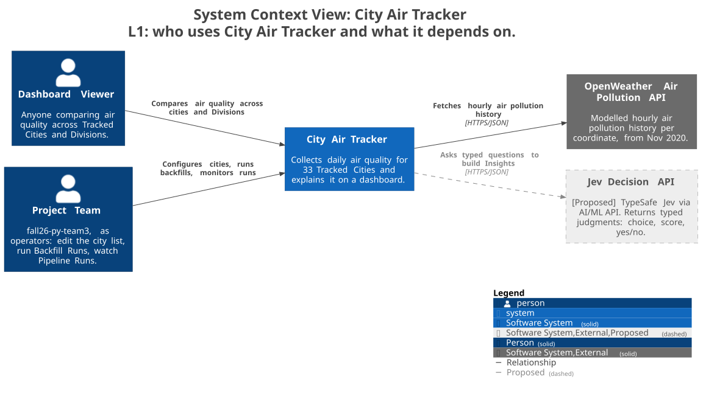
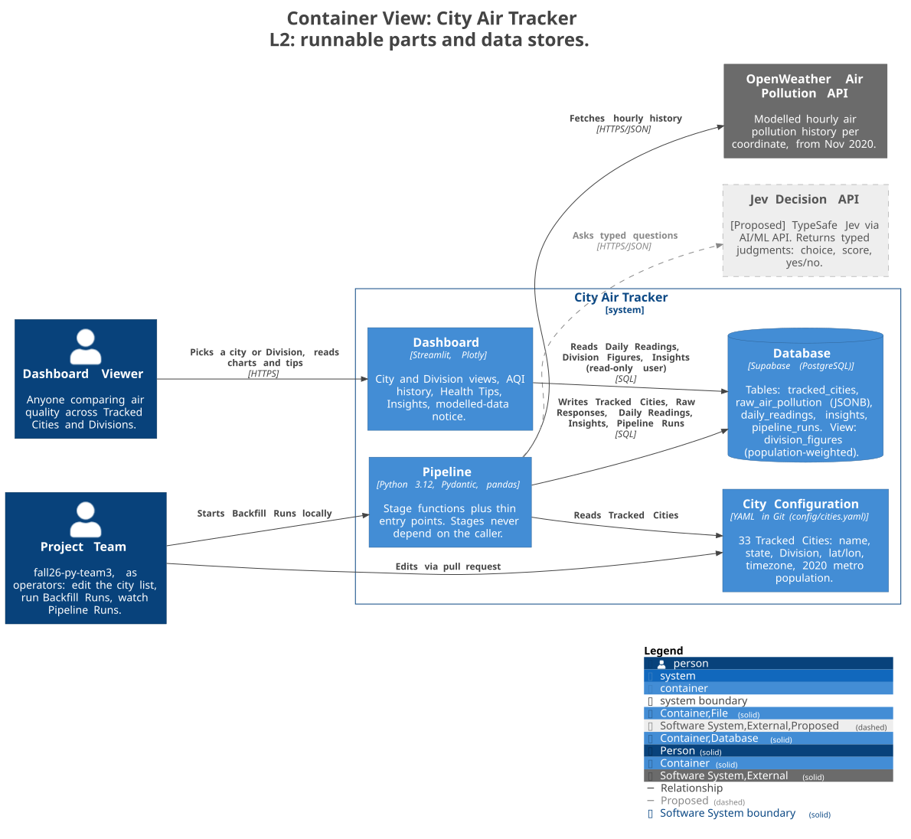
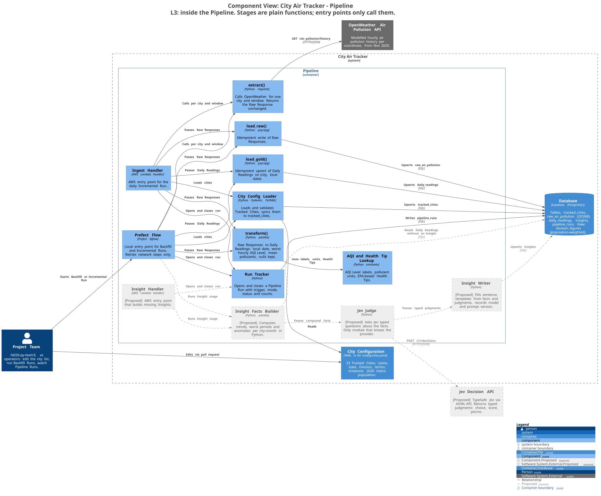
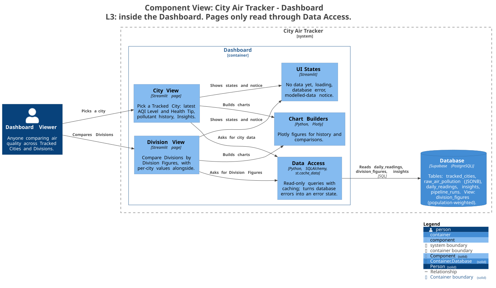
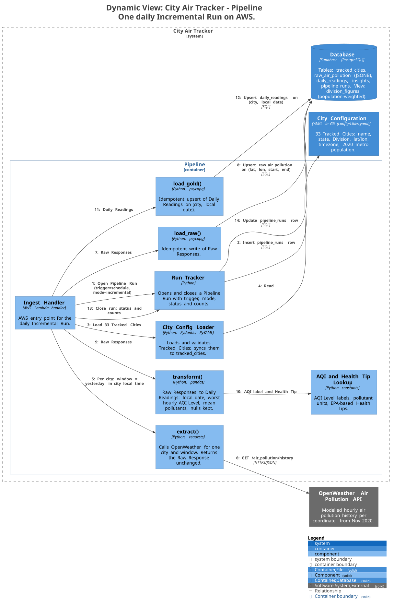
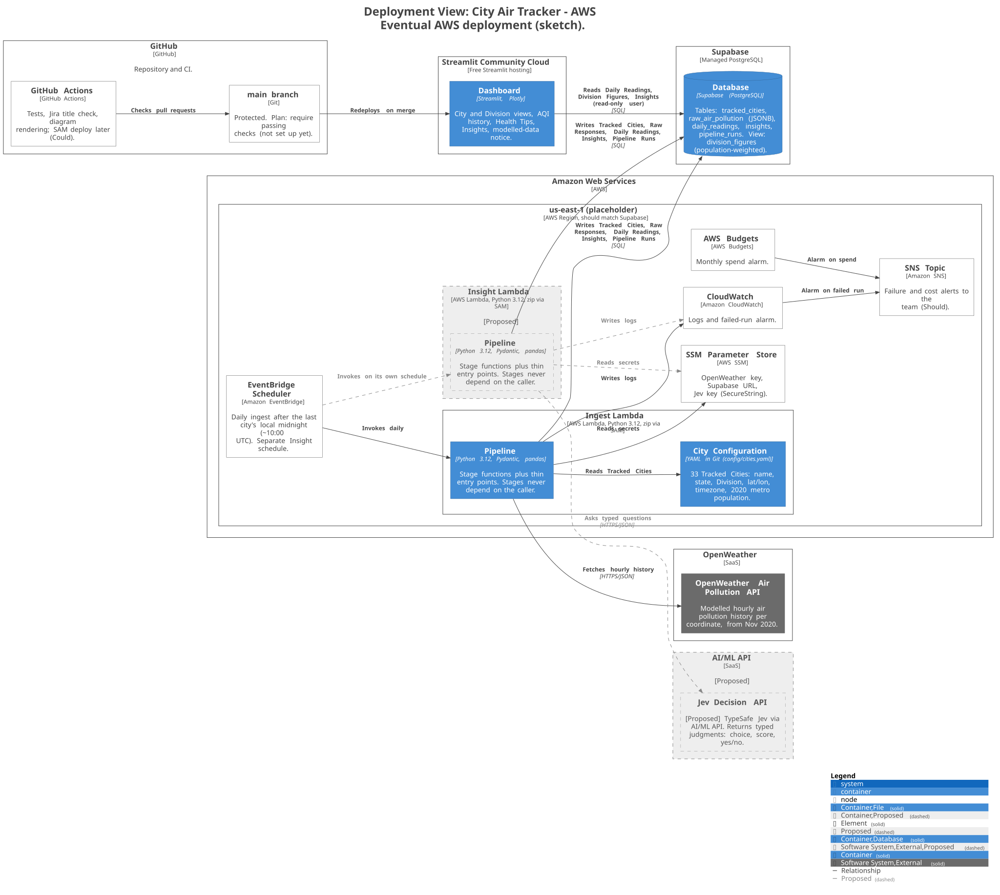

# Architecture

C4 diagrams for City Air Tracker. They are a **plan** and will change as the team learns more.

- Source of truth: [`workspace.dsl`](./workspace.dsl) ([Structurizr DSL](https://docs.structurizr.com/dsl)). One model, many views, so a rename shows up in every diagram.
- Terms: [`CONTEXT.md`](../../CONTEXT.md). Decisions: [`team-decisions.md`](../../team-documentation/team-decisions.md) and [`docs/adr/`](../adr/).
- Grey, dashed elements are **Proposed** (not agreed yet), see [ADR 0001](../adr/0001-use-jev-for-insights.md).

[C4](https://c4model.com) zooms in step by step: L1 shows the system as one box, L2 opens it into runnable parts, L3 opens one part into its components. Deployment and Dynamic views are side views: where things run, and what happens in what order.

## Updating the diagrams

Diagrams are code: you change them by editing text in `workspace.dsl`, not by drawing. The layout is automatic.

1. **Try things out (optional):** paste the DSL into [playground.structurizr.com](https://playground.structurizr.com) and edit it; diagrams update as you type. Nothing is saved to the repo, so copy your final DSL back.
2. **Edit with a live preview:** run `docs/architecture/preview.sh` (needs Docker), open http://localhost:8080, edit `workspace.dsl` in your editor, save, refresh the browser.
3. **Render and commit:** run `docs/architecture/render.sh` and commit `workspace.dsl` together with the changed SVGs. Never edit the SVGs by hand.
4. If you forget step 3, the `Architecture diagrams` GitHub Action re-renders and commits the SVGs on your branch.

Editor support: VS Code has [Cornifer](https://github.com/RVR06/cornifer) (highlighting, completion, preview); JetBrains IDEs have [Structurizr DSL Language Support](https://github.com/dirkgroot/structurizr-dsl-intellij-plugin) (highlighting only). DSL reference: [docs.structurizr.com/dsl](https://docs.structurizr.com/dsl).

Dragging boxes in the preview does not change the committed SVGs; they are always laid out automatically.

## L1: System Context

**What:** City Air Tracker as one box, the people who use it, and the outside services it depends on.
**Why:** the 30-second picture for anyone new: who gets value, and which external APIs we cannot control.
**How to read:** the Project Team is us acting as operators; the Dashboard Viewer is anyone reading the results.

## L2: Containers

**What:** the separately runnable parts and data stores: City Configuration, Pipeline, Database, Dashboard.
**Why:** shows how data moves (OpenWeather → Pipeline → Supabase → Dashboard) and which part owns each job.
**How to read:** the Pipeline is the only writer; the Dashboard only reads, with a read-only database user.

## L3: Pipeline components

**What:** the stage functions inside the Pipeline and the two entry points that call them (Prefect locally, Lambda on AWS).
**Why:** stages stay plain functions that do not know who calls them, so the same code runs on a laptop and in the cloud.
**How to read:** follow `extract() → load_raw() → transform() → load_gold()`; the grey chain at the bottom is the proposed Insight stage.

## L3: Dashboard components

**What:** the Streamlit pages and the helpers they share: data access, charts, and UI states.
**Why:** keeps all database access in one place and makes the non-happy states (no data, loading, error) visible parts of the design.
**How to read:** pages never query the database directly; Division Figures come ready-made from the `division_figures` view.

## Dynamic: one daily Incremental Run

**What:** the numbered steps of one scheduled run on AWS, from opening a Pipeline Run to closing it.
**Why:** makes the order, the idempotent writes, and the run tracking explicit, which is what Sprint 3 and 4 reviews ask about.
**How to read:** follow the numbers 1 to 14; every write is an upsert, so rerunning the same day is safe.

## Deployment: AWS (sketch)

**What:** where each part will run: Lambdas and supporting AWS services, Supabase, Streamlit Community Cloud, GitHub.
**Why:** the cloud phase target, so Sprint 4 and 5 tickets have a shared picture; region and details are still open.
**How to read:** EventBridge starts the Ingest Lambda daily; secrets come from SSM; failures and spend alarms go to SNS.

