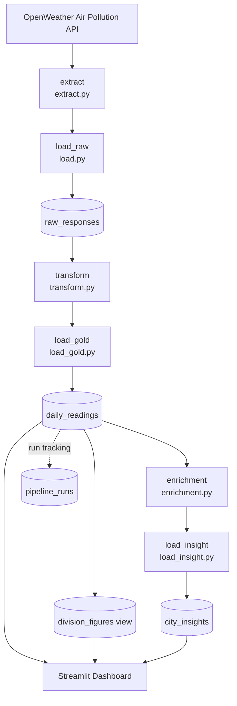
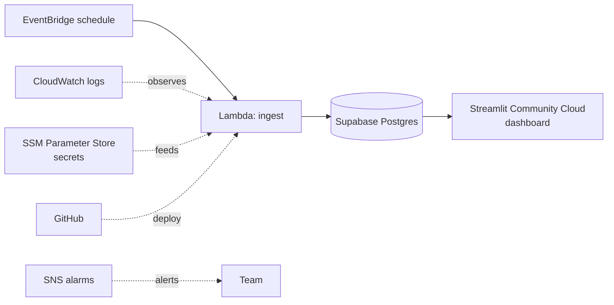

# Architecture

City Air Tracker: compares air quality across U.S. cities and Census divisions over time.

Diagrams are written in [Mermaid](https://mermaid.js.org/) inside this file, so they render on GitHub and edit like normal text — no tools, no Docker, no rendering step. Edit the code block, save, commit.

Vocabulary: [`CONTEXT.md`](../CONTEXT.md). Decisions: team Jira / PRs.

## 1. Data flow

Every write is an upsert, so rerunning the same day is safe. The dashboard only reads.

## 2. Components and where to edit

| Component | File | Key function | Sprint |
|---|---|---|---|
| Extract | `services/pipeline/src/pipeline/extract/extract.py` | `extract()` | 1 |
| Load raw | `services/pipeline/src/pipeline/load/load.py` | `load_raw()` | 2 |
| Transform | `services/pipeline/src/pipeline/transform/transform.py` | `transform()` | 2 |
| Load gold | `services/pipeline/src/pipeline/load/load_gold.py` | `load_gold()` | 2 |
| Enrichment | `services/pipeline/src/pipeline/enrichment/enrichment.py` | `enrichment()` | 3 |
| Load insight | `services/pipeline/src/pipeline/load/load_insight.py` | `load_insight()` | 3 |
| Insight data | `services/pipeline/src/pipeline/insight_data.py` | `get_gold_records()` | 3 |
| Dashboard | `services/pipeline/src/pipeline/dashboard/` | `dashboard_app.py`, `air_quality.py`, `daily.py`, `charts.py`, `navigate.py` | 3 |
| Orchestration | `services/pipeline/run_pipeline.py` | `main()` | 3 |
| Run tracking | `services/pipeline/src/pipeline/run_tracking.py` | — | 3 |

## 3. AWS deployment (Sprints 4–5)

Region, IAM roles, and secret names are settled in Sprint 4.

## Run types

- **Backfill Run**: loads a historical date range (full history since Nov 2020).
- **Incremental Run**: adds only dates not yet loaded (normally yesterday).

## Data contracts

Pydantic schemas live in `data_contracts/schemas` (imported by extract). Keep them in sync with the database tables.

## Idempotency and reruns

Every write is an upsert keyed by `(city, date)`. Rerunning the same day replaces rows instead of duplicating them, so both Backfill Runs and Incremental Runs are safe to repeat.

## Run tracking

Each execution is recorded as a `Pipeline Run` in `pipeline_runs` with its trigger, status, and counts (cities, raw responses, gold rows). A failure is recorded with an error message and does not block later runs.